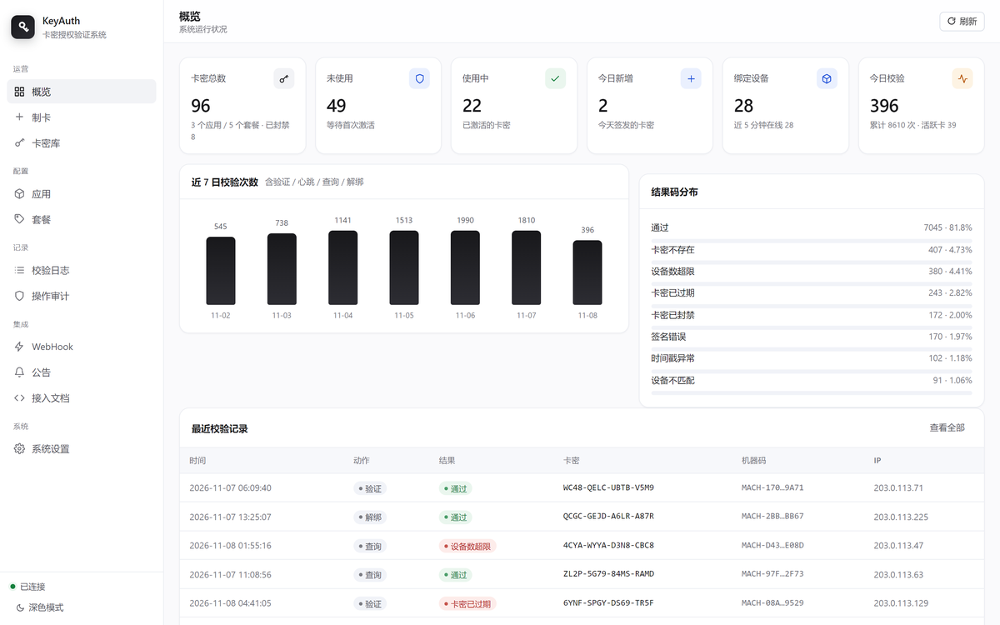

# KeyAuth · License Key System

> Self-hosted licensing backend for desktop software. **Zero dependencies** — Python standard library only. Runs on a 1-core 1 GB box.

<p>
  <a href="https://github.com/Ytong825/keyauth/actions/workflows/ci.yml"></a>
  
  
  
  
</p>

A complete license-key stack: **admin console**, **authorization engine**, and **signed HTTP API**.
Issue keys, bind machines, enforce device limits, renew, and inspect logs — no Redis, no MySQL, no Docker, no `pip install`.



> Chinese docs are the primary reference: [README.md](README.md) · [API](docs/API.md) · [Deploy](docs/DEPLOY.md).

---

## Why

You shipped software and need to answer four questions:

1. **Did this user pay?** → key state machine (unused / active / expired / used_up / banned)
2. **Is it being passed around?** → machine-id binding + device cap + rebind limit
3. **Monthly or lifetime?** → day cards and hour cards, both counted from activation
4. **What went wrong?** → full verification log, result-code distribution, admin audit trail

Most alternatives require PHP + MySQL, or keep your data on someone else's server.
This one is a single directory + SQLite, and the data stays with you.

## Features

| Area | Capability |
|---|---|
| **Issue keys** | Batch up to 10,000 per call, custom prefix, batch tag, copy / export |
| **Key types** | Day card (0 = lifetime), hour card |
| **Key library** | Search, filter by status / app / type / batch, pagination, per-page size, jump-to-page, bulk actions, CSV export |
| **Apps** | Multi-tenant by AppID + AppSecret, rotate secret independently |
| **Plans** | Issuing presets (type + duration + devices + rebinds + price) |
| **Engine** | Auto-activate on first verify, machine binding, multi-device, self-service rebind |
| **Security** | HMAC-SHA256 signing, timestamp skew, nonce replay guard, per-IP rate limit |
| **Ops** | Verify logs with date range, result distribution, 7-day trend, audit trail |
| **Integration** | Webhooks (activated / bound / unbound), announcements, hot DB backup |
| **UI** | Hand-written CSS, no CDN, dark mode, command palette |

## Quick start

```bash
git clone https://github.com/Ytong825/keyauth.git
cd keyauth
python server.py
```

The console prints the admin URL and a generated admin token. Data lives in `data/keyauth.db`.

Run the 99-case end-to-end suite:

```bash
python tests/selftest.py
```

## Deploy

```bash
git clone https://github.com/Ytong825/keyauth.git ~/keyauth
cd ~/keyauth && sudo bash install.sh
```

Installs systemd unit + Nginx reverse proxy, binds to `127.0.0.1:8787`, prints the admin URL.

The admin token is auto-generated (32 random bytes). To pick your own instead:

```bash
sudo ADMIN_TOKEN='your-token' bash install.sh
```

The console flags weak tokens (under 12 chars, all digits or all letters) with a dismissible
banner — a warning, not a lock. Short tokens on a private box are a legitimate choice.

HTTPS needs a domain (Let's Encrypt will not issue for a bare IP):

```bash
sudo bash deploy/enable_https.sh auth.example.com
```

Full guide: [docs/DEPLOY.md](docs/DEPLOY.md) · Docker: `docker compose up -d --build`

## Client integration

Copy [`client_demo.py`](client_demo.py) into your app and change two constants:

```python
from client_demo import KeyAuth

ka = KeyAuth("https://auth.example.com", "app_7c1f9a3e5d2b8640", "YOUR_APP_SECRET")
r = ka.verify("WC48-QELC-UBTB-VSMP")
print(r["data"]["expires_text"])     # "2026-12-08 05:00:00"
```

Endpoints: `verify` / `heartbeat` / `query` / `unbind` under `/api/v1/`.

Ready-made clients (zero dependencies): [`client_demo.py`](client_demo.py) (Python) ·
[`examples/client.cs`](examples/client.cs) (C#, no NuGet) ·
[`examples/client_eyuyan.md`](examples/client_eyuyan.md) (易语言, no third-party modules).

**Signing**: all parameters except `sign`, sorted by name (ASCII), joined as `k=v&k=v`, HMAC-SHA256 with AppSecret, lowercase hex.

```text
app_id=xxx&code=yyy&machine_id=zzz&nonce=n&ts=1730000000
sign = hex(hmac_sha256(app_secret, above))
```

Full protocol, error codes and multi-language signing samples: [docs/API.md](docs/API.md), [docs/CLIENT.md](docs/CLIENT.md).

## Architecture

```
Client ──HMAC──▶ Nginx :443 ──▶ 127.0.0.1:8787 ──▶ server.py
                                                    ├─ httpd.py     routing + static
                                                    ├─ service.py   verify chain + state machine
                                                    ├─ admin.py     admin business logic
                                                    ├─ security.py  sign / nonce / rate limit
                                                    └─ db.py        SQLite layer
                                                              │
                                                        data/keyauth.db
```

Request chain: `route → token → params → rate limit → timestamp skew → nonce → HMAC → state machine → log`.
Every failure is written to `logs` with a structured code. Details: [docs/ARCHITECTURE.md](docs/ARCHITECTURE.md).

## Security notes

Built in: parameterized SQL, `hmac.compare_digest`, replay protection, 64 KB body cap,
path-traversal guard, security headers, two-step confirmation on destructive actions.

**You must**: put it behind Nginx on `127.0.0.1`, enable HTTPS, use a strong admin token,
and back up `data/keyauth.db` regularly. Report vulnerabilities per [SECURITY.md](SECURITY.md).

## Docs

[API](docs/API.md) · [Client](docs/CLIENT.md) · [Deploy](docs/DEPLOY.md) ·
[Architecture](docs/ARCHITECTURE.md) · [FAQ](docs/FAQ.md) · [CHANGELOG](CHANGELOG.md) ·
[Contributing](CONTRIBUTING.md)

## Support

MIT licensed, free to use — no paid tier, no feature locks, no telemetry.

- **Star the repo** — the most effective exposure a solo project can get
- **File issues** with version, symptoms and repro steps
- **Send a client example** for a language missing from `examples/` (Go, Rust, Delphi…)

Want to chip in for the server bill? [docs/SPONSOR.md](docs/SPONSOR.md) has the QR codes.

## License

[MIT](LICENSE) © 2026 Ytong825
