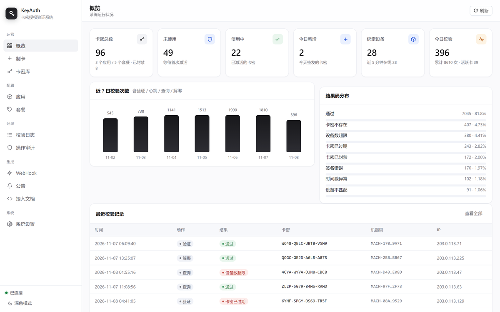
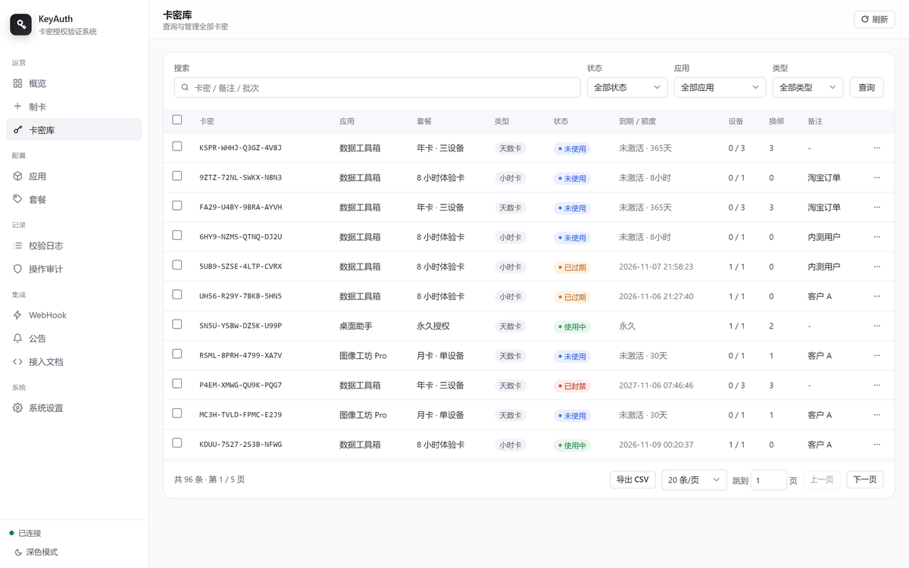
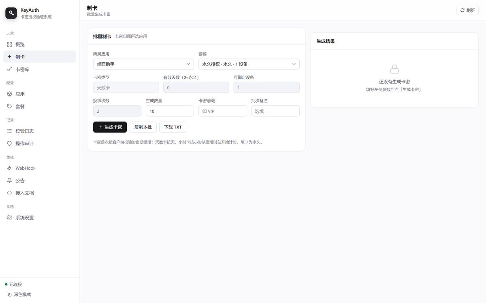
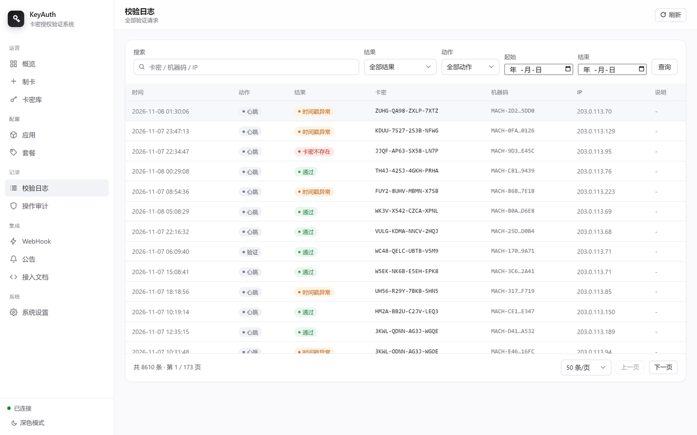
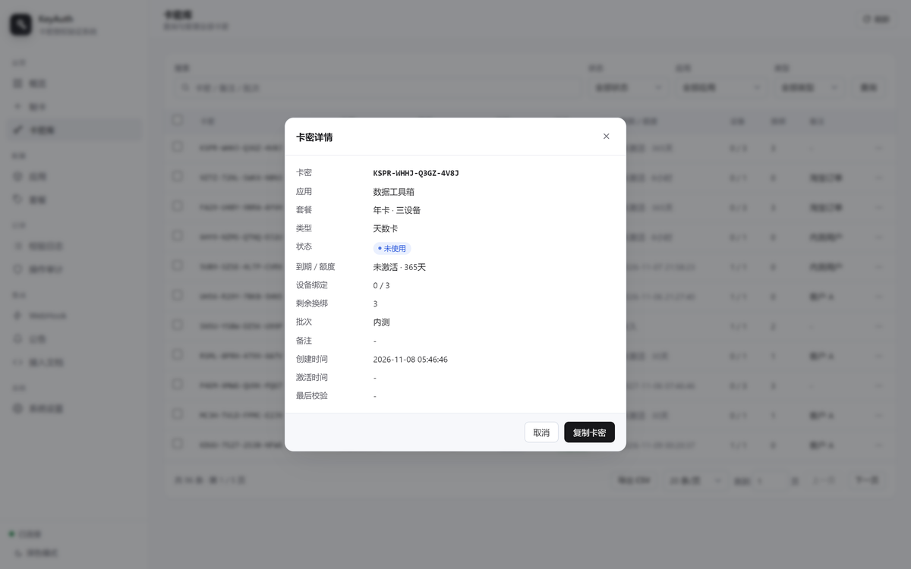
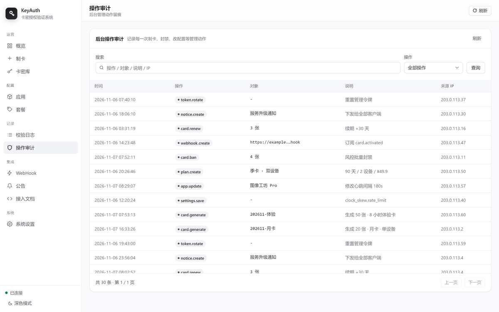
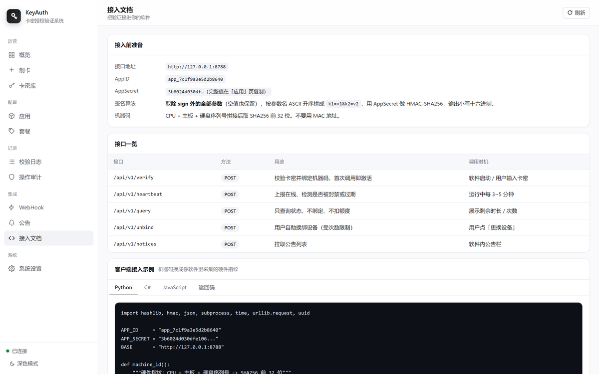
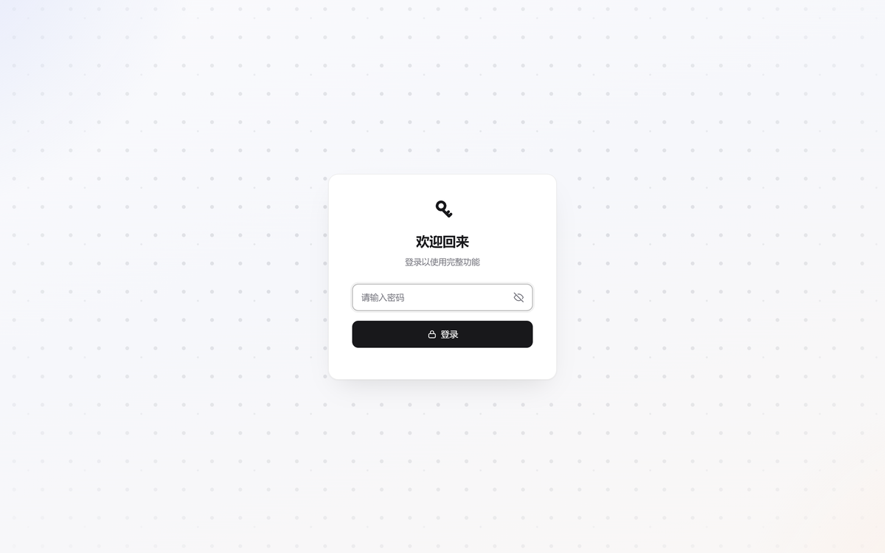

# KeyAuth · 卡密授权系统

> 给软件做卡密授权与发卡的自托管后端。**纯 Python 标准库，零依赖**，一台 1 核 1G 的机器就能跑。

**简体中文** | [English](README.en.md)

<p>
  <a href="https://github.com/Ytong825/keyauth/actions/workflows/ci.yml"></a>
  <a href="https://github.com/Ytong825/keyauth/releases"></a>
  
  
  
  
  
</p>

一套完整的卡密（License Key）系统，包含**管理后台**、**授权引擎**和**对外验签接口**三部分。
装完就能发卡、绑机、限设备、续期、看日志，不需要 Redis / MySQL / Docker / 任何 pip 包。



---

## 目录

- [它解决什么问题](#它解决什么问题)
- [功能](#功能)
- [30 秒本地跑起来](#30-秒本地跑起来)
- [部署到服务器](#部署到服务器)
- [客户端接入](#客户端接入)
- [接口一览](#接口一览)
- [架构](#架构)
- [目录结构](#目录结构)
- [安全设计](#安全设计)
- [运维](#运维)
- [文档](#文档)
- [常见问题](#常见问题)
- [支持这个项目](#支持这个项目)
- [许可证](#许可证)

---

## 它解决什么问题

你写了个软件想卖，需要回答四个问题：

1. **这个用户有没有付钱？** → 卡密状态机（未激活 / 使用中 / 过期 / 额度用尽 / 封禁）
2. **是不是同一个人在到处传？** → 机器码绑定 + 设备数上限 + 换绑次数限制
3. **他付的是一个月还是永久？** → 天数卡 / 小时卡，从激活时刻开始计时
4. **出问题怎么查？** → 全量校验日志、结果码分布、后台操作审计

同类产品大多要求 PHP + MySQL，或者把数据放在别人的服务器上。
这个项目是**单文件部署 + SQLite + 零依赖**，数据完全在自己手里。

### 和别的方案比

| | 本项目 | KeyAuth 官方 | 常见 PHP 发卡网 | 账号 + 订阅制 |
|---|---|---|---|---|
| 部署 | 一个目录，`bash install.sh` | 用他们的云（或自建 PHP） | 装宝塔 + 导 SQL | 要接支付渠道 |
| 数据在哪 | **你的服务器** | 他们的服务器 | 你的 | 你的 |
| 依赖 | 0 | PHP + MySQL | PHP + MySQL | 后端 + 支付 SDK |
| 成本 | 一台小机器 | 免费档有限制 | 服务器 + 域名 | 支付手续费 0.6%~1% |
| 适合 | 一次性买断的桌面软件 | 想省事、量大 | 习惯 PHP 的人 | 有支付资质、做订阅 |

**什么时候别用这个** —— 先说清楚，省得你部署完才发现不合适：

- 你要做**订阅制自动续费**：应该走微信支付 / Stripe 的订阅 API，卡密是手工发卡的过渡方案
- 你的用户**必须有账号体系**（多设备同步、云端数据）：卡密只解决授权，不解决身份
- 你需要**团队协作管理**（多管理员、权限分级）：现在是单令牌，没有账号体系
- 你的量**超过每天十万次校验**：SQLite 写入会成瓶颈，该换 PostgreSQL + 多实例

卡密这套模型能解决的问题很具体：**没有支付资质、软件不能常驻联网、一次性买断**。
出了这个范围，它就不是最优解。

## 功能

| 模块 | 能力 |
|---|---|
| **制卡** | 批量生成（单次最多 10000 张）、卡密前缀、批次备注、一键复制 / 导出 TXT |
| **卡密类型** | 天数卡（0 = 永久）、小时卡 |
| **卡密库** | 搜索、按状态 / 应用 / 类型 / 批次筛选、分页、每页条数、跳页、多选批量操作、CSV 导出 |
| **卡密详情** | 点行查看 13 项字段（绑定设备、换绑余量、激活时间、最后校验…），一键复制 |
| **多账号** | 管理员账号 + 三级角色（拥有者 / 管理员 / 只读）；配置文件里的超级令牌仍可用于脚本 |
| **两步验证** | TOTP（RFC 6238）+ 8 个一次性恢复码，零依赖；登录连错 5 次锁 15 分钟 |
| **防误操作** | 删账号 / 改密 / 关别人的两步验证，都要把账号名敲一遍，服务端也校验 |
| **应用** | 多应用隔离，每个软件一套 AppID + AppSecret，可单独重置密钥 |
| **代理商** | 分销账号 + 按「应用 × 卡规格」发配额；只能制卡和操作自己的卡，没有删除权，动作实时同步到主后台 |
| **套餐** | 制卡预设：类型 + 时长 + 设备数 + 换绑次数 + 价格，制卡时直接选 |
| **授权引擎** | 首次校验自动激活、机器码绑定、多设备限制、自助换绑（次数可配） |
| **安全** | HMAC-SHA256 签名、时间戳容差、nonce 防重放、IP 限流、强制签名开关 |
| **运营** | 校验日志（分页 + 日期范围）、结果码分布、7 日趋势、后台审计 |
| **数据维护** | 日志按保留天数自动回收、备份列表与一键下载、数据库体积可见 |
| **集成** | WebHook 回调（激活 / 绑定 / 解绑）、公告下发、数据库热备份 |
| **后台 UI** | 手写 CSS，无 CDN 依赖，深色模式，全键盘命令面板 |

<details>
<summary>更多截图（点击展开）</summary>

**卡密库** —— 分页、筛选、点行看详情


**制卡** —— 选套餐自动填参数，也可以手填


**校验日志** —— 按结果 / 动作 / 日期范围查


**卡密详情**


**操作审计** —— 谁在什么时候改了什么


**接入文档** —— 后台自带，地址跟随配置


**登录页**


</details>

## 30 秒本地跑起来

```bash
git clone https://github.com/Ytong825/keyauth.git
cd keyauth
python server.py
```

终端会打印管理令牌：

```
  管理后台  http://127.0.0.1:8787/admin
  管理令牌  1f3a...（首次启动生成，存在 data/config.json）
```

打开后台、粘贴令牌、开始制卡。数据落在 `data/keyauth.db`，删掉这个目录就是全新环境。

跑一遍回归测试（100 项，覆盖鉴权链、状态机、限流、注入、静态穿越）：

```bash
python tests/selftest.py
```

> 需要 Python 3.8+。没有其他依赖，`pip install` 一次都不用。

### 给自己开个账号

超级令牌（`data/config.json` 里那串）是给脚本和监控用的。日常登录更适合用账号密码：

1. 用超级令牌登进后台 → **系统设置 → 管理员账号 → 新建账号**，填账号、密码（至少 8 位）、角色选「拥有者」
2. 点右上角 **退出**
3. 登录页点「用账号密码登录」，输刚建的账号

之后再退出，登录页会记住你上次用的是哪种方式，不用每次重新切换。
同一个卡片里还有「我的两步验证」，需要的话可以绑 TOTP（可选，不绑照常登录）。

## 部署到服务器

### 一键脚本（推荐）

```bash
git clone https://github.com/Ytong825/keyauth.git ~/keyauth
cd ~/keyauth && sudo bash install.sh
```

脚本会：建系统用户 → 装 systemd 服务 → 配 Nginx 反代 → 装数据库备份定时任务 → 打印后台地址与令牌。

服务只监听 `127.0.0.1:8787`，公网一律经 Nginx。

**管理令牌**：首次启动自动生成 32 字节随机串，够用。想自己定一个好记的：

```bash
sudo ADMIN_TOKEN='你的令牌' bash install.sh
```

后台会检测令牌强度，短于 12 位或纯数字时在概览页顶部弹一条可关闭的提醒——
**只提示，不强制**，自己人的机器用短口令图方便是合理的。

### Docker

```bash
docker compose up -d --build
```

端口映射写死 `127.0.0.1:8787`。**不要改成 `8787:8787`** —— Docker 的端口发布绕过 ufw，等于把服务直接挂到公网。

### HTTPS

Let's Encrypt 不给纯 IP 签证书，需要一个解析到本机的域名：

```bash
sudo bash deploy/enable_https.sh auth.example.com
```

脚本负责：解析比对 → 装 certbot → 备份 Nginx 配置 → 换 server_name → 申请证书 → 301 跳转 → 检查自动续期。失败会打印回滚命令。

上完 HTTPS 记得去后台「系统设置 → 对外访问地址」填 `https://auth.example.com`，
这样「接入文档」里给客户端的地址才是 https。

详细说明见 [docs/DEPLOY.md](docs/DEPLOY.md)。

## 客户端接入

把 [`client_demo.py`](client_demo.py) 拷进你的软件，改两行：

```python
from client_demo import KeyAuth

ka = KeyAuth(
    "https://auth.example.com",   # 服务端地址
    "app_7c1f9a3e5d2b8640",       # AppID（后台「应用」页）
    "你的 AppSecret"               # AppSecret
)

r = ka.verify("WC48-QELC-UBTB-VSMP")   # 首次激活
if r["ok"]:
    print("到期：", r["expires_text"], "剩余", r["remaining_seconds"], "秒")
else:
    print("拒绝：", r["msg"])
```

运行期每 3 分钟发一次心跳：

```python
r = ka.heartbeat(卡密)
if not r["ok"]:
    sys.exit("授权失效：" + r["msg"])
```

现成的客户端示例（都零依赖，拷走改两行常量就能用）：

| 语言 | 文件 | 说明 |
|---|---|---|
| Python | [`client_demo.py`](client_demo.py) | 零依赖，四个接口 + 机器码全封装 |
| C# | [`examples/client.cs`](examples/client.cs) | 单文件，.NET Framework 4.6+ / .NET 6+，不引 Newtonsoft |
| 易语言 | [`examples/client_eyuyan.md`](examples/client_eyuyan.md) | 不依赖任何模块，HMAC 走系统 CNG，HTTP 走 WinHttp |

其他语言照 [docs/CLIENT.md](docs/CLIENT.md#签名实现) 里的签名算法自己实现即可（给了 JS / C# / Go 片段）。

> **字段名注意**：服务端读的机器码字段是 `machine_id`，不是 `machine`。

## 接口一览

客户端接口（需要签名，`POST` + JSON）：

| 接口 | 用途 |
|---|---|
| `POST /api/v1/verify` | 首次激活 / 换机校验 |
| `POST /api/v1/heartbeat` | 运行期心跳 |
| `POST /api/v1/query` | 查询状态（不激活） |
| `POST /api/v1/unbind` | 自助解绑当前设备 |
| `GET  /api/health` | 健康检查（免鉴权） |

管理端接口走 `X-Admin-Token` 头，共 20 余个，完整列表与参数见 [docs/API.md](docs/API.md)。

**签名规则**：除 `sign` 外所有参数参与，按参数名 ASCII 升序拼接（空值也保留），用 AppSecret 做 HMAC-SHA256，十六进制小写。

```text
app_id=xxx&code=yyy&nonce=zzz&timestamp=1730000000
sign = hex(hmac_sha256(app_secret, 上面的字符串))
```

## 架构

```
                     ┌──────────────────────────────┐
   软件客户端 ───────▶│  Nginx :443 / :80            │
   (带 HMAC 签名)     │  ├─ /admin  静态后台         │
                     │  ├─ /api/   限流 20r/s       │
                     │  └─ /static 静态资源         │
                     └──────────────┬───────────────┘
                                    │ 127.0.0.1:8787
                     ┌──────────────▼───────────────┐
                     │  server.py  (ThreadingHTTP)  │
                     │  ├─ httpd.py    路由 + 静态   │
                     │  ├─ service.py  授权核验核心  │
                     │  ├─ admin.py    管理端业务    │
                     │  ├─ security.py 签名/防重放/限流│
                     │  ├─ webhook.py  事件回调      │
                     │  └─ db.py       SQLite 访问层 │
                     └──────────────┬───────────────┘
                                    │
                              data/keyauth.db
                              （卡密 / 绑定 / 日志 / 审计）
```

请求链：`路由 → 令牌校验 → 参数校验 → 限流 → 时间戳容差 → nonce 去重 → HMAC 验签 → 业务状态机 → 日志落库`。
任何一环失败都会写入 `logs` 并返回结构化错误码，客户端可据此给用户准确提示。

数据模型与状态机细节见 [docs/ARCHITECTURE.md](docs/ARCHITECTURE.md)。

## 目录结构

```
keyauth/
├─ server.py                 启动入口
├─ client_demo.py            客户端接入示例（拷进你的软件改两行）
├─ install.sh                一键安装（systemd + Nginx + 可选 HTTPS）
├─ update.sh                 更新：语法自检 → 备份 → 重启 → 健康检查
├─ kauth/
│  ├─ config.py              配置加载与持久化
│  ├─ db.py                  SQLite 访问层 + 表结构 + 迁移
│  ├─ security.py            签名 / 防重放 / 限流
│  ├─ service.py             授权核验核心（状态机 / 设备绑定 / 额度）
│  ├─ admin.py               管理端业务（制卡 / 卡密 / 应用 / 套餐 / 日志）
│  ├─ agent.py               代理商：配额、制卡、受限操作
│  ├─ webhook.py             事件回调
│  ├─ httpd.py               HTTP 服务与路由
│  └─ util.py                工具函数
├─ static/                   管理后台（手写 CSS，无 CDN）
├─ docs/                     文档与截图
├─ tests/selftest.py         端到端自测（99 项）
├─ deploy/                   HTTPS 脚本 / Nginx 模板 / Docker 方案
└─ data/                     运行时生成：config.json（含令牌）+ keyauth.db
```

> `data/` 在 `.gitignore` 里 —— 它含管理令牌和全部卡密数据，**绝不能进版本库**。

## 安全设计

**已内置**

- SQL 全参数化；`hmac.compare_digest` 比对签名与令牌，防时序攻击
- 时间戳容差（默认 300s）+ nonce 去重（默认 600s）防重放
- 业务层 IP 限流（后台可配）+ Nginx 传输层兜底
- 请求体上限 64KB，字段长度与嵌套层数限制
- 管理接口不发 CORS `*`；静态目录穿越防护
- 安全响应头：`X-Content-Type-Options` / `X-Frame-Options` / `Referrer-Policy`
- 敏感操作（重置令牌 / 删应用 / 删卡密）全部二次确认，并写审计

**部署时必须做**

1. 用 Nginx 反代，服务只监听 `127.0.0.1`
2. 上 HTTPS —— http 明文传输，运营商和中间人能看到卡密
3. 管理令牌别用弱口令；泄露了立刻在后台「系统设置 → 重置管理令牌」
4. 定期备份 `data/keyauth.db`（后台有「立即备份」按钮，`install.sh` 也装了定时任务）

发现安全问题请按 [SECURITY.md](SECURITY.md) 的方式私下报告，不要开公开 issue。

## 运维

```bash
systemctl status keyauth          # 状态
journalctl -u keyauth -f          # 实时日志
systemctl restart keyauth         # 重启
cp ~/keyauth/data/keyauth.db ~/备份-$(date +%F).db   # 手动备份
```

更新代码：

```bash
cd ~/keyauth && git pull && sudo bash update.sh
```

`update.sh` 会先跑语法自检，不过就中止，不会把服务改挂。

## 文档

| 文档 | 内容 |
|---|---|
| [docs/API.md](docs/API.md) | 全部接口、参数、错误码；管理员账号与角色见[同名小节](docs/API.md#管理员账号) |
| [docs/CLIENT.md](docs/CLIENT.md) | 客户端接入：签名实现、机器码设计、心跳容错 |
| [docs/AGENT.md](docs/AGENT.md) | 代理商：开号、分配配额、权限边界 |
| [docs/DEPLOY.md](docs/DEPLOY.md) | 部署、HTTPS、反代、备份、迁移、排错 |
| [docs/ARCHITECTURE.md](docs/ARCHITECTURE.md) | 架构取舍、数据模型、状态机、请求链 |
| [docs/FAQ.md](docs/FAQ.md) | 常见问题（按选型 / 部署 / 接入 / 安全分组） |
| [ROADMAP.md](ROADMAP.md) | 下一步做什么、明确不做什么 |
| [CHANGELOG.md](CHANGELOG.md) | 版本记录 |
| [CONTRIBUTING.md](CONTRIBUTING.md) | 开发环境、提交规范、PR 流程 |
| [SUPPORT.md](SUPPORT.md) | 遇到问题该去哪儿问 |
| [docs/SPONSOR.md](docs/SPONSOR.md) | 赞助方式与用途 |

## 常见问题

**Q：为什么不用 FastAPI / Flask？**
A：目标机器常常是客户给的 1 核小机器，装 pip 包可能要编译、可能要外网。`http.server` 的 `ThreadingHTTPServer` 足够撑这类低频接口，代价是路由要手写。

**Q：能撑多少量？**
A：单实例 SQLite 写入串行，持续 200 req/s 左右的校验 + 心跳没有明显排队（日志表对 `ts` / `code` / `result` 建了索引）。再往上建议换 PostgreSQL 或加只读副本。

**Q：卡密被人到处传怎么办？**
A：「卡密库」按卡密能看绑定机器码和最后校验 IP，支持批量封禁。封禁后下一次心跳直接拒绝。

**Q：客户端被破解、跳过验证怎么办？**
A：这是客户端防护问题，不在本项目范围。本项目保证「服务端判定可靠」；加壳 / 反调试 / 关键逻辑下沉属于另一半工程。

**Q：能换成 MySQL 吗？**
A：`kauth/db.py` 是唯一的 SQL 入口，换数据库只需替换这一层（约 200 行）。

更多见 [docs/FAQ.md](docs/FAQ.md)。

## 支持这个项目

MIT 协议，免费用，没有付费版、没有功能锁、没有遥测。如果它帮你省了几天工：

- **点个 Star** —— 个人项目最有效的曝光，比什么都实在
- **提 issue** —— 带上版本、现象、复现步骤，比「用不了」有用得多
- **补客户端示例** —— 你用 Go / Rust / Delphi / 易语言接入的，欢迎提 PR，并进 `examples/`

愿意赞助服务器费用的话，[docs/SPONSOR.md](docs/SPONSOR.md) 里有收款码，也写了钱花在哪。

## 许可证

[MIT](LICENSE) © 2026 Ytong825

用这个项目赚钱不需要付我钱，也不用署名。
